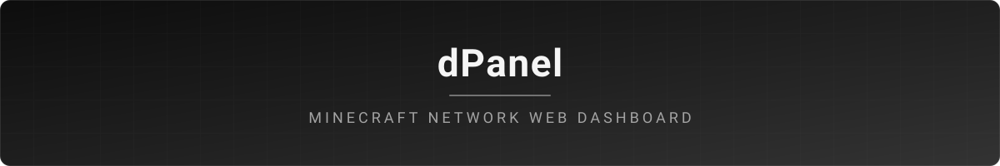

  

  
  
  
  
  
  
  </a>
  

---

### Sobre o Projeto

O **dPanel** é um painel web full-stack e plataforma de análise de métricas de código aberto desenvolvido para integrar e monitorar os plugins [dBounty](https://github.com/diogocorreadcs/dBounty) e [dClanSystem](https://github.com/diogocorreadcs/dClanSystem), utilizando Node.js/TypeScript, Python (FastAPI + Pandas) e Next.js com Tailwind CSS.

---

### Funcionalidades

* **Painel & Rankings:** Lista de procurados com avatares 3D, ranking de caçadores e classificação de clãs.
* **Analytics & Métricas:** Volume em recompensas ativas, histórico financeiro e análise de horários de pico.
* **Moderação & Integração:** Remoção de recompensas, sincronização via API REST e autenticação por chave (`x-api-key`).

---

### Endpoints da API

* `GET /api/health` — Status operacional da API (Pública)
* `GET /api/bounties` — Lista de jogadores procurados (Pública)
* `GET /api/bounties/top-hunters` — Ranking dos maiores caçadores (Pública)
* `DELETE /api/bounties/:uuid` — Remove recompensa ativa (`x-api-key`)
* `GET /api/clans` — Lista de clãs por pontuação (Pública)
* `GET /api/clans/:name` — Detalhes e membros de um clã (Pública)
* `POST /api/sync/clan` — Sincroniza dados do `dClanSystem` (`x-api-key`)
* `GET /analytics/overview` — Métricas e horários de pico em Python (Pública)

---

### Arquitetura e Instalação

O projeto é um monorepo dividido em `api-node/` (Node.js/Prisma), `analytics-python/` (FastAPI/Pandas) e `web-nextjs/` (Next.js), todos conectados a um banco MySQL (`dpanel_db`).

Para rodar os serviços localmente, configure o arquivo `.env` em cada diretório e execute:
* **API Node.js (Porta 3333):** `npm install`, `npx prisma db push`, `npm run dev`
* **Analytics Python (Porta 8000):** `pip install -r requirements.txt`, `uvicorn main:app --reload --port 8000`
* **Frontend Next.js (Porta 3000):** `npm install`, `npm run dev`

---

### Contribuição

Projeto Open Source sob licença MIT. Pull requests e sugestões são bem-vindos no repositório.
